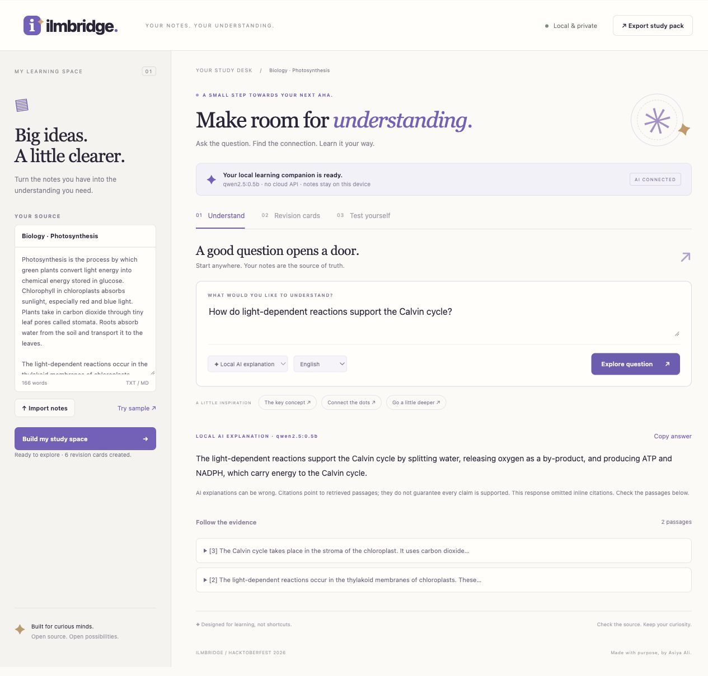

# IlmBridge
### Your notes. Your understanding.

A local-first study companion for students: turn course notes into searchable evidence, AI explanations, revision cards, and scored practice. Built by **Asiya Ali** for Hacktoberfest Hack Day, NSTP/NUST Islamabad, 27 October 2026.



## Why this exists
Students often have course material but need help turning it into a study routine. Cloud subscriptions and uploading private notes can add barriers. IlmBridge brings source search, recall practice, and a small open-source language model into one local workspace.

## What works
- Paste up to 40,000 characters of notes or import `.txt` / `.md` files.
- Ask a question and retrieve up to two original numbered passages using BM25-style ranking.
- Run **Qwen2.5 0.5B Instruct** locally through Ollama for a short explanation with source references.
- Request English, Urdu, or Roman Urdu explanations (quality varies; the small model is strongest in English).
- Flip six source-derived revision cards and complete a six-question gap-fill exercise.
- Check exact answers and inspect the sentence supporting each one.
- Export notes, cards, the latest answer and evidence as Markdown.
- Use source search and practice without downloading a model. This mode is explicitly labelled and does not simulate AI inference.

Public repository: https://github.com/aggravating08/ilmbridge

## Run it
Requires **Python 3.10+**. No Python packages are needed for the app or its automated tests.

```sh
cd ilmbridge
python3 server.py
```
Open **http://127.0.0.1:8765**. The application binds only to loopback. It is a local application; it is not a hosted multi-user service.

### Enable the open-source AI model
Install Ollama from https://ollama.com, then in separate terminals:

```sh
ollama serve
ollama pull qwen2.5:0.5b
python3 server.py
```
If the Ollama desktop app already runs the server, skip `ollama serve`. Reload IlmBridge after downloading the model. Select **Local AI explanation**, then ask a question. The quantized model download is about 398 MB. Internet is needed for initial installation/download; inference can run offline afterward. Hardware must support Ollama.

On the development machine, a downloaded runtime is retained under the ignored `.runtime/` directory. Run `./start-local.sh` to reuse it. Model weights and runtime binaries are excluded from the source ZIP and Git repository.

Optional configuration:

```sh
ILMBRIDGE_MODEL=qwen2.5:0.5b python3 server.py --port 8765
```
`ILMBRIDGE_OLLAMA` defaults to `http://127.0.0.1:11434`. Keep it local to preserve the privacy guarantee. Changing it to a remote service sends retrieved passages and questions to that service.

## Try the demo
The built-in biology sample is original demonstration text. Ask:

> How do light-dependent reactions support the Calvin cycle?

Inspect the numbered evidence, open **Revision cards**, flip a card, then **Test yourself**. Enter `Photosynthesis` for the first sample gap and check the score. Export a study pack.

Full presenter script: [docs/DEMO.md](docs/DEMO.md).

## Architecture

```text
Browser (notes held in memory)
  -> Python HTTP API on 127.0.0.1
     -> bounded text passages -> BM25-style lexical retrieval
        -> exact source excerpts OR local Ollama /api/chat
     -> sentence-derived cloze cards and quiz
  -> evidence panels + local Markdown download
```

`study.py` implements retrieval, prompting, citation-ID checks, and practice generation. `server.py` validates API requests and serves the interface. `static/` contains dependency-free HTML, CSS, and JavaScript. Notes are sent to the local Python process when needed; in AI mode, only retrieved passages and the question go to local Ollama. The application writes no notes or question history to disk. Ollama is a separate process with its own configuration. Exported files are intentionally saved by the user.

## Verification

```sh
python3 -m unittest discover -s tests -v
```

19 automated tests cover passage ranking, two-stage retrieval, no-match abstention, Unicode tokenization, exact-source quiz reconstruction, model error handling, invalid citation rejection, API validation, same-origin protection and security headers. Model calls in unit tests are mocked to isolate failure cases; separate live evidence is documented in [docs/VALIDATION.md](docs/VALIDATION.md).

## Limits and honest claims
- Citations validate **reference IDs**, not semantic truth. A real source reference can still accompany an unsupported claim. Read the evidence.
- Retrieval matches words rather than semantic meaning. Paraphrases can fail, and partial overlap does not prove the notes contain an answer.
- No PDF ingestion, OCR, accounts, cloud synchronization, or long-term progress tracking in this prototype.
- Practice generation currently uses English terms; non-English source search is supported at token level.
- Quiz marking is case-insensitive exact matching, not semantic grading. Blank answers count as incorrect.
- Small models can ignore prompts, mistranslate, or omit citations. Prompt injection resistance is best-effort. Use trusted course material and inspect model output.
- SDG benefits are design intentions, not measured learning outcomes. No students have been enrolled in a user study.

## SDGs
**SDG 4 - Quality Education:** supports self-directed revision through source-based explanations and practice. Local execution avoids a required cloud subscription; no learning-effectiveness claims have been measured.

**SDG 10 - Reduced Inequalities:** free code, source-only operation and selectable explanation languages aim to reduce cost and language barriers. Running AI still requires compatible hardware and the initial model download.

## Original contribution & authorship
Asiya Ali is the named participant and maintainer. This is a newly created standalone project, separate from other projects in the parent workspace. Code, interface, prompts, tests and documentation were produced with Codex assistance during this session. No use of Kiro is claimed. The participant should review and understand the implementation before presenting it. Do not represent generated development as unaided work or claim unverified collaboration.

## License and acknowledgements
Application: **MIT**, see [LICENSE](LICENSE).

- Qwen team: [Qwen2.5-0.5B-Instruct](https://huggingface.co/Qwen/Qwen2.5-0.5B-Instruct), **Apache-2.0**. Downloaded separately, not bundled.
- Ollama: https://github.com/ollama/ollama, **MIT**. Local inference runtime, downloaded separately.
- Python standard library, Python Software Foundation license.
- ReportLab (BSD) and pypdf (BSD-3-Clause) are used only to generate/verify the report, not to run the application.
- SDG definitions: https://sdgs.un.org/goals/goal4 and https://sdgs.un.org/goals/goal10.

## Contribute
See [CONTRIBUTING.md](CONTRIBUTING.md). Good next issues: multilingual evaluation, semantic retrieval, PDF text ingestion, and teacher-reviewed practice sets.
